# 赣风·可对话的数字展——作品说明文档

- 竞赛：2026 年第十四届全国大学生数字媒体科技作品及创意竞赛
- 赛道：指定命题 ·「科技+创意，讲好中国故事」作品赛项
- 参赛方向：（1）中华优秀传统文化数字化表达；（3）非遗、文旅主题创作
- 作品形式：互动网页 / 数字展陈（可离线运行）
- 团队成员与分工：【待填写】　指导教师：【待填写】　参赛单位：【待填写】
- 文档版本：草稿 v0.2（2026-11-03）

## 摘要

本作品是一个可离线运行的互动数字展，以景德镇瓷器、王勃《滕王阁序》和赣南客家围屋为三条参观线。与常见的文化展示不同，本作品把「什么能成立」写成一张可审计的约束表：访客选择朝代与釉色、情境与意象、房间与时辰，系统按「合 / 勉 / 冲」三档判定；冲突组合会被改锁到规则允许的选项，并在矩阵上回放判定过程。每条规则都能展开出处原文、网址和访问日期，也能用「试一下」现场复现。问展在浏览器内用 BGE-small-zh-v1.5 检索展内题库，低于阈值即拒答。共登记 25 条出处，其中 2 条服务扩展演示线，其余服务三条主线，全部打开原页核对；25 条里有 2 条为二手资料。

关键词：数字展陈；非物质文化遗产；约束表；可审计性；离线推理

## 1 选题与价值

### 1.1 问题：宋代的瓶子配上清代粉彩

文化类数字内容常出现两种错误：一是「时代穿越」，二是「张冠李戴」。前者如宋代的瓶子配上清代才出现的粉彩——粉彩创烧于康熙晚期，成熟于雍正、乾隆两代 [1]，上海博物馆的展览资源页给出相同结论 [2]；后者如把不同诗文的意象拼在一幅画面里，看上去热闹，却经不起原句核对。

观众很难自己判断真伪。多数作品只给结论，不给依据；即使标了「参考」，也常常是一个打不开的链接或一段没有出处的解说。本作品要解决的，就是把这层依据交还给观众。

### 1.2 作品定位：三条主线与一条扩展线

本作品用三条江西文化参观线讲中国故事：

- 瓷语：景德镇瓷器的器型、釉色与年代。
- 阁序：王勃《滕王阁序》的名句与夜景中的滕王阁。
- 客家：赣南围屋（walled Hakka house）的空间与一天之中的时辰。

门厅另有一个「万寿宫」入口，是扩展演示线，用西山万寿宫庙会的活动与时段检验同一套约束表。它不属于本文的三条主线，第 5 节的完成度数据也不含这一线。

本作品不追求生成更多内容，而是把「为什么这样讲」做成可以展开、可以复核的界面：规则有出处，判定有记录，结论可以当场重跑。三维场景、展柜和器物均为程序生成，界面在相应位置标注「程序复原示意」或「示意模型·无实物尺寸」，不与史实断言混用。门厅布局见图 1。

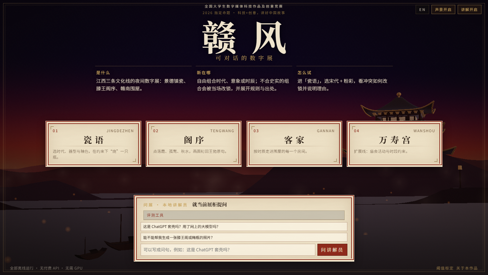

*图 1　门厅。三条主线入口（瓷语、阁序、客家）、扩展演示入口（万寿宫）、三步导览与问展输入框；底部标明离线运行。截图：screenshots/01-门厅.png。*

### 1.3 目标用户与场景

- 博物馆、文旅展厅的数字导览屏。
- 中小学和高校的传统文化课堂演示。
- 线上的文化传播页面。

作品离线运行，适合网络条件差的展厅与教室。整个展项不依赖外部接口，断网时仍可完成参观、判定和问展。

## 2 叙事设计

### 2.1 三条线、三类规则

三条线共用一套判定逻辑，但依据的性质不同。瓷语依托可查证的年代与工艺事实；阁序把意象钉回原文；客家的空间要素有出处，时辰搭配则是本展的叙事约定。三类规则在界面上分开标注，避免把设计选择说成史料。三条线的分工见表 1。

表 1　三条参观线与三类规则

| 参观线 | 讲什么 | 约束表 | 规则类型 |
|---|---|---|---|
| 瓷语 | 景德镇制瓷（国家级非遗，2006 第一批）[3] | 朝代 × 釉色 | 史实约束：依据故宫博物院等词条原文 |
| 阁序 | 《滕王阁序》（公有领域原文）[4] | 情境 × 意象 | 文本锚定：意象出自哪一句可核对原文；「冲」是设计约定 |
| 客家 | 赣南客家围屋（营造技艺国家级非遗，2014）[5] | 房间 × 时辰 | 叙事约定：空间要素有官方出处，时辰搭配明示「非史料」 |

瓷语的约束表把朝代与釉色交叉。粉彩创烧于康熙晚期 [1]；青花在元代已能成熟烧制 [6]；青白瓷（影青）由景德镇湖田窑在北宋初、中期独创 [7]；元代景德镇已能烧高温铜红釉，初创阶段呈色偏暗，明代永乐、宣德时期烧出纯正鲜艳的红釉 [8][9]；五彩在明宣德时已有，清代康熙朝成为彩瓷的主流 [10]。器型取梅瓶、玉壶春瓶、觚、斗笠碗、折沿盘五类，分别依据故宫博物院词条、藏品页与常州市武进区博物馆的藏品说明 [11][12][13][14][15][16]。三档判定本身是本展的规则，不是出处原文；出处支撑的是年代与工艺事实。瓷语展柜的锁定状态见图 2。

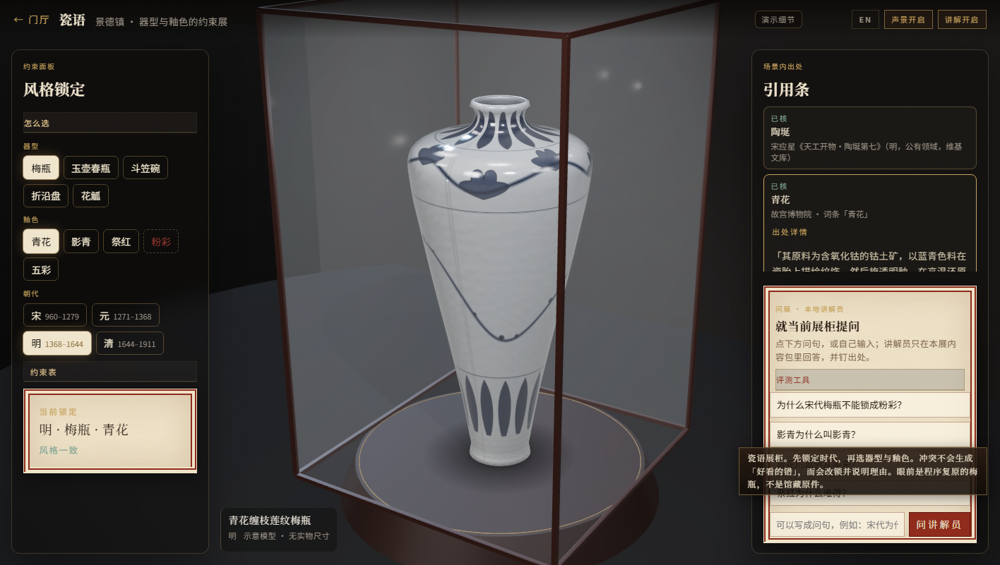

*图 2　瓷语。左侧为器型、釉色与朝代约束面板，右侧引用条展开「青花」词条原文；展柜中的梅瓶为程序生成示意模型，标注「示意模型·无实物尺寸」。截图：screenshots/02-瓷语.png。*

阁序把《滕王阁序》的意象钉回原句。「落霞与孤鹜齐飞，秋水共长天一色」锁定「落霞」「孤鹜」「秋水」[4]；「渔舟唱晚，响穷彭蠡之滨；雁阵惊寒，声断衡阳之浦」分属两个地名锚点，彭蠡是鄱阳湖的古称之一 [17]，衡阳雁的说法见《光明日报》的考证文章 [18]。原文给出的是文本依据；哪一格判「冲」，是本展「一个情境只锁一个地名锚点」的设计约定，界面标为「本展说明」。夜景与锁定状态见图 3。

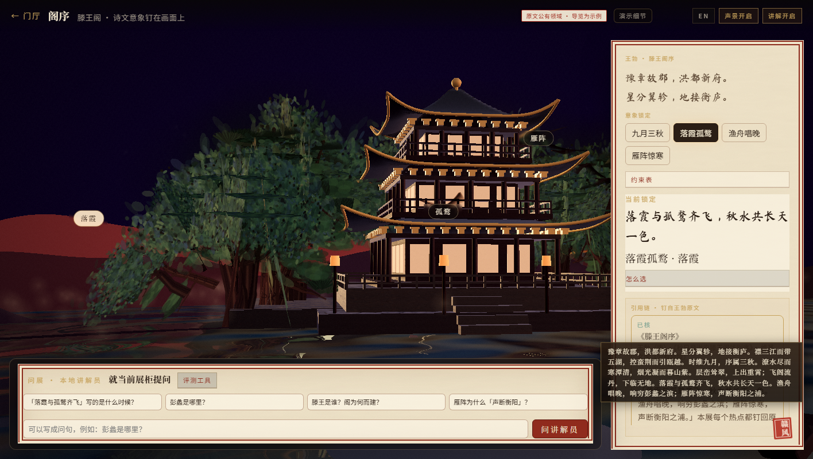

*图 3　阁序。夜景中的滕王阁与「落霞」「孤鹜」标签，右侧为《滕王阁序》原文与引用条；建筑与材质为程序化示意，不是测绘复原。截图：screenshots/03-阁序.png。*

客家线用「房间 × 时辰」组织动线。围屋中轴线是祠堂，四角各建一座角楼（炮楼）；乌石围的围前有禾坪 [20]。天井、正屋、横屋、巷道、外走马等术语按万幼楠《客家民居与赣南围屋》的原文使用 [21]。这些是空间事实。哪一间房对应哪个时辰，则是本展的叙事约定，界面每一格都写着「时辰搭配是本展叙事约定（非史料）」。客家围屋与福建土楼是两类建筑，土楼「或方或圆，以圆为主」[5][22]，本作品没有把两者混称。围屋门楼与祖堂内景分别见图 4、图 5。

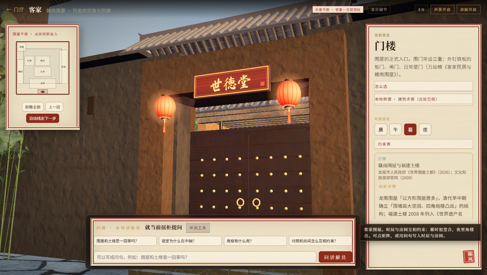

*图 4　客家。围屋正式入口「世德堂」门楼，左侧为自绘 SVG 平面，右侧为「门楼」词条与三重围门的出处。截图：screenshots/04-客家门楼.png。*

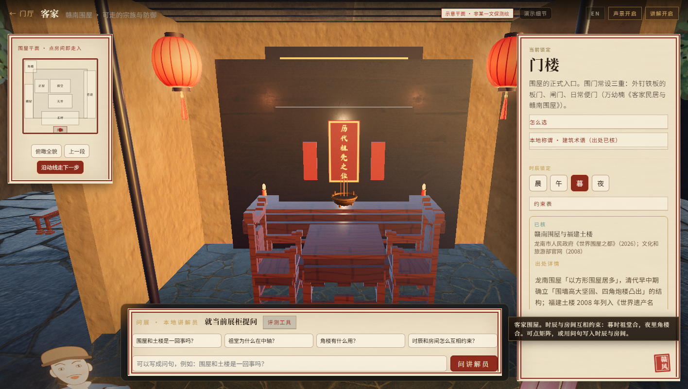

*图 5　客家。祖堂内景，供桌上方为「历代祖先之位」牌位；左侧平面为自绘示意，时辰选择为「暮」。截图：screenshots/05-客家祖堂.png。*

### 2.2 「赣鄱千年」参观顺序

门厅导览给出一个建议顺序，从唐代文本读到清代器物，再走进围屋：

1. 先读唐代王勃的《滕王阁序》。
2. 再看景德镇的年代约束：北宋青白瓷、元代成熟青花、清代粉彩。
3. 走进赣南围屋，例如清嘉庆三年（1798）始建、道光七年（1827）竣工的龙南关西新围 [20]。

顺序不是硬性规定，访客可以从任意一条线进入。每一步的出处都可以在审计面板里展开；导览中的描写性文案属于创作性说明，不作为史实断言。

### 2.3 合 / 勉 / 冲与改锁

访客点选组合，或用一句话提问，比如「宋代的粉彩梅瓶」。系统查约束表，给出三档结果：

- 合：成立。
- 勉：勉强成立，附说明。
- 冲：不成立。系统自动改锁到该列的推荐项，例如宋代的粉彩改锁为影青，并在矩阵上用箭头动画回放「冲突格 → 规则条目 → 改锁格」。回放可以重放，也可以停在任意一步查看依据。

改锁不是替访客「选一个好看的」，而是把冲突显式地摆出来：先说明哪一格不成立，再给出规则条目，最后落到允许的格子。改锁结果见图 6：顶部提示与左下矩阵同时显示「拒绝『粉彩』→ 改锁『影青』」。

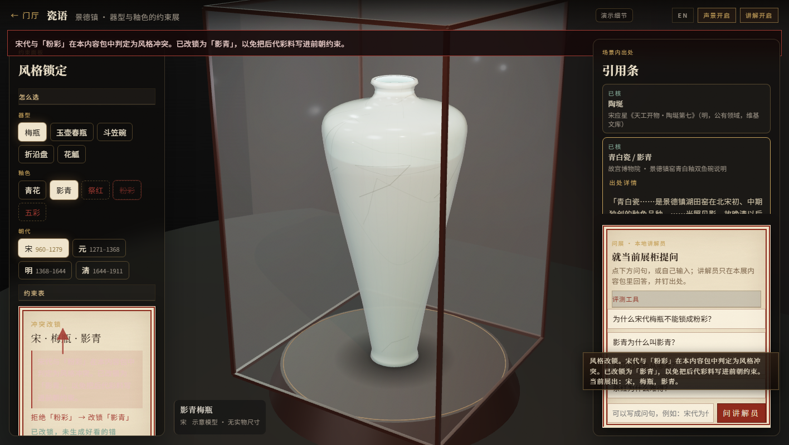

*图 6　瓷语。宋代 × 粉彩判为「冲」，系统改锁到「影青」，顶部提示与左下矩阵同时显示「拒绝『粉彩』→ 改锁『影青』」。截图：screenshots/11-瓷语冲突改锁.png。*

### 2.4 扩展演示线：西山万寿宫庙会

门厅第 4 个入口「万寿宫」是一条扩展演示线，用来检验同一套 `lookup()` 引擎换一套内容后还能不能工作。它把庙会活动（开朝进香、戏班演出）与时段（晨旦、白日、夜晚）交叉，只有两格有原文锚点：项目页写「八月（号净月）初一晨旦开朝」「夜晚民间戏班演出」[23]，因此「开朝 × 晨旦」判合、「戏班 × 夜晚」判合；其余四格为本展设计约定，界面上不称史料。

这条线登记 2 条出处：中国非物质文化遗产网的项目页 [23]，以及文化和旅游部政府信息公开的第三批国家级非物质文化遗产名录通知 [24]。戏台场景是程序复原示意，页首标明「非测绘」，不是对某一座戏台原址的测绘复原。该线不进入三条主线的统计，也不新增问展题库条目，以免影响第 4.4 节的标定数字。戏台场景见图 7。

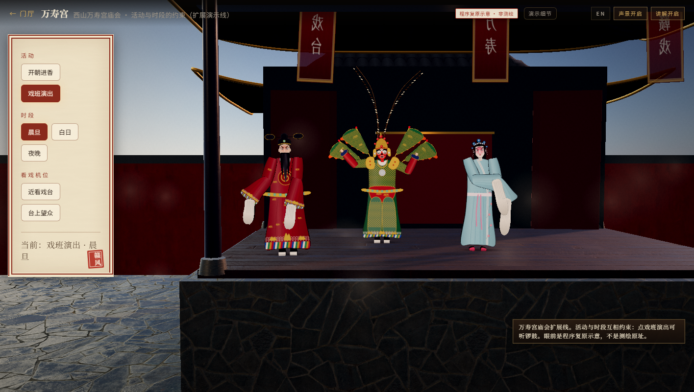

*图 7　万寿宫扩展演示线。活动选「戏班演出」、时段选「晨旦」，戏台人物为程序复原示意；页首标明「程序复原示意·非测绘」。截图：screenshots/07-万寿戏台.png。*

## 3 内容准确性

### 3.1 出处登记

`src/data/sources.ts` 现登记 25 条公开出处，状态全部为「已核」（代码中 status: verified），即页面已直接打开、摘录逐字核对。登记构成见表 2。其中 2 条服务扩展演示线，其余服务三条主线；25 条里有 2 条是二手资料：维基百科「滕王阁」条目 [19]，以及万幼楠的署名文章《客家民居与赣南围屋》[21]。每条都记录题名、机构、网址、访问日期和原文摘录。

表 2　出处登记构成（`src/data/sources.ts`，2026-10-08 与 2026-10-16 两次核对）

| 类别 | 说明 |
|---|---|
| 三条主线 | 瓷语、阁序、客家；明细见《出处核对表》 |
| 扩展演示线 | 西山万寿宫庙会，2 条 |
| 合计 | 25 条，状态均为「已核」；其中 2 条为二手资料 |

主要来源如下：

- 故宫博物院：粉彩、红釉、鲜红釉、五彩、青花、湖田窑青白瓷、梅瓶、玉壶春瓶、觚、笠式碗、元青花折沿花口盘。
- 上海博物馆：粉彩，作旁证；常州市武进区博物馆：北宋景德镇窑青白釉斗笠碗。
- 中国非物质文化遗产网：景德镇手工制瓷技艺；西山万寿宫庙会（扩展线）。
- 维基文库：《滕王阁序》《天工开物·陶埏》原文。
- 生态中国网：鄱阳湖古称彭蠡泽。
- 《光明日报》：衡阳雁。
- 龙南市人民政府：围屋数量、关西新围、乌石围。
- 万幼楠《客家民居与赣南围屋》（客家摇篮网）：围门、禾坪、竖向天井、正屋横屋、外走马、炮楼等空间术语。
- 文化和旅游部：福建土楼列入世界遗产；第三批国家级非物质文化遗产名录通知（扩展线）。
- 维基百科：滕王阁始建与重建，二手资料。

### 3.2 状态分级

界面上每条引用都盖章标明状态：

- 已核：出处已逐字核对。
- 本展说明：本展的设计约定，不是史实断言。
- 待核：没找到可公开查证的出处。

另有「示例」一档，用于没有公开出处、仅作演示的内容。三维场景与展柜另标「程序复原示意」或「示意模型·无实物尺寸」，与引用条上的状态章分开，避免观众把示意模型当成馆藏原件。

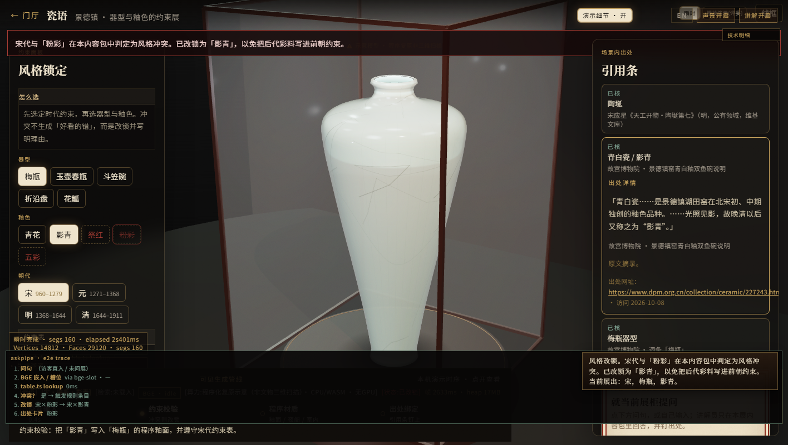

*图 8　审计面板。右侧引用条展开「青白瓷/影青」的原文摘录、出处网址与访问日期，左下为本次判定的技术明细。截图：screenshots/12-审计验证.png。*

第二轮补核后，原先待核的折沿盘年代、景德镇斗笠碗、4 条围屋房间功能、客家词条和上博页面都已用可打开的原页核实，或按原文改写；无出处的 7 条方言词条已删除，换成有原文的空间术语。仍需说明的有三处：滕王阁年份目前只有维基百科（二手）可查；客家「房间 × 时辰」表是叙事约定；导览里的描写性文案不是史实断言。逐条对照见《出处核对表》。

### 3.3 本轮核对中纠正的错误

- 「灯草口」的成因按故宫词条改为「釉层高温垂流变薄露胎」[8]，不是铜挥发。
- 元代 × 祭红由「冲」改为「勉」：景德镇元代已能烧铜红，只是呈色偏暗 [8]。
- 删除原来虚构的展品尺寸，改为「示意模型 · 无实物尺寸」。
- 「二元配方」原来误挂在《天工开物》名下 [25]，改引非遗网的元代说法 [3]。

## 4 交互与技术实现

### 4.1 技术路线

- 前端：Vite 5 + TypeScript；三维展柜用 three.js 0.170（WebGL2）。
- 器型：用 LatheGeometry 由轮廓线旋转生成。
- 釉面：程序绘制的画布纹理。
- 围屋：自绘 SVG 示意平面。
- 作品不使用文物照片或第三方三维模型。

### 4.2 共享约束引擎

三条线共用同一个 `lookup(grid, col, row)` 函数和 `fallbackRow` 改锁规则（`src/app/table.ts`）。约束表是普通数据，可以打印、审计和修改。瓷语的矩阵允许访客临时改格；改过之后，审计面板会提示「当前表已被改动」，并把当前表与依据对照，避免把一次临时修改误当成固定规则。

### 4.3 审计面板：从展示到验证

每个展区的审计面板分三层：

1. 本次判定的原始记录：列、行、结果、改锁项。
2. 规则依据：只显示已核出处的原文摘录，附网址和访问日期。
3. 同类验证案例：命中、边界、例外各一例。点「试一下」会用默认约束表现场复现，并显示「实测结果与依据一致 / 不一致」。

第三层是这套界面与普通「参考资料」弹窗的区别。观众不只看作者说「这条规则有出处」，还可以用默认表跑一遍，看结果是否与依据对得上。见图 8，右侧是第二层的原文摘录与网址，左下是本次判定的技术明细。

### 4.4 问展：浏览器端检索，不生成

- 在浏览器内用 Transformers.js 载入 BGE-small-zh-v1.5（ONNX 8 位量化，约 24 MB），用 CPU/WASM 计算句向量，与展内题库做余弦相似度检索。
- 低于阈值的问题直接拒答，不接云端大模型，也不调用付费接口。
- 模型载入失败时自动回退到词面检索，界面会显示当前用的是哪条路径。
- 意图槽位匹配的阈值 0.40 是在自建的 58 条金标问上测出来的，召回 87.6%，精确 82.8%，见 `public/thresh-bench.json`。
- 问展作答阈值 0.55 用 101 条标定问确定（题库内改写问 61、题库外问 40）：在 dev 47 问上选定，另用 54 问 holdout 检验，召回 88.2%、精确 78.9%。同主题、问法不同的题库外问题（如「滕王阁门票多少钱」）仍可能答成同主题的题库条目，答案会附出处卡。详见 `docs/calib/README.md`。
- 以上问句都由开发过程自建，不是独立评测集。

拒答的实际界面见图 9：输入「滕王阁门票多少钱」后，讲解员说明题库未收录，不把句子送往外部模型。`?arch` 面板见图 10，上半部分列出三条主线共用的 `lookup()` 调用点，下半部分是 58 条金标问上的阈值扫描。

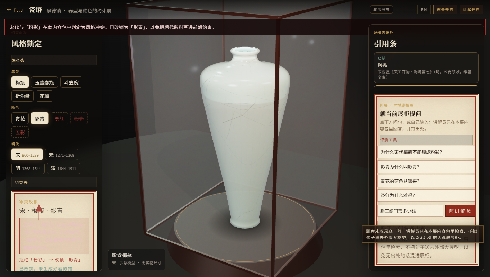

*图 9　问展。输入「滕王阁门票多少钱」后，讲解员说明题库未收录并拒答，不把句子送往外部大模型。截图：screenshots/13-问展拒答.png。*

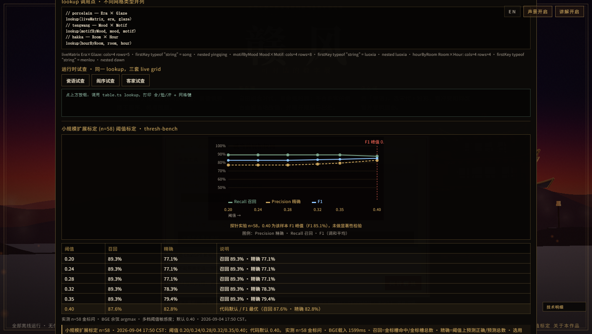

*图 10　架构与阈值面板（`?arch`）。上部为三条主线共用的 `lookup()` 调用点，下部为 58 条金标问上的阈值扫描；默认槽位阈值 0.40 处召回 87.6%、精确 82.8%。截图：screenshots/14-架构阈值.png。*

### 4.5 离线一键运行

- 字体本地化：SIL OFL 字体按展内用字裁剪，三个文件合计约 2 MB。
- 不依赖任何外部网络。
- 随包提供 Go 便携静态服务器（Windows、macOS、Linux），以及 Python 和 PowerShell 两个备用服务器。
- 详见《运行环境》。

### 4.6 中英双语界面

界面提供中文 / EN 切换。界面文案、展项说明和问展的示例问句有项目自译的英文版本；出处原文与文言原句保留中文，英文自译附在其后。译文不是馆方官方释文；英文界面中的机构名与题名同为项目自译，核对时以中文原页为准。

术语表统一了围屋、土楼、祖堂、角楼、天井、禾坪等词的译法，避免同一建筑在不同页面出现不同译名。英文门厅与英文瓷语展柜分别见图 11、图 12；两处的展项说明与引用条标题都是项目自译。

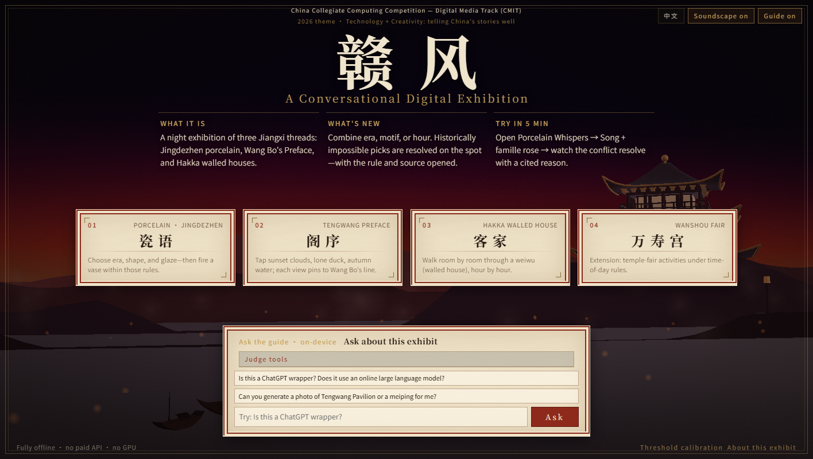

*图 11　英文门厅。界面语言切换为 EN 后，三条主线与扩展线入口的说明、问展输入框均为英文，入口名称仍保留中文，展名保留「赣风」二字。截图：screenshots/08-英文门厅.png。*

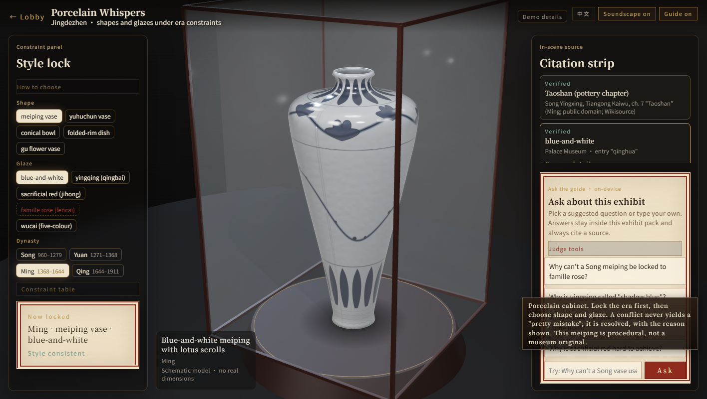

*图 12　英文瓷语。展项说明与引用条标题为项目自译，不是馆方官方释文；器物仍为程序生成示意模型。截图：screenshots/10-英文瓷语.png。*

## 5 完成度与可验证性

- 构建：`npm run build`（tsc 类型检查 + vite 打包）通过。
- 离线包：约 130 MB，压缩后约 48 MB。
- 已在 Linux 上验证：便携服务器和 Python 服务器的 MIME（wasm、woff2）正确，无头浏览器打开门厅时外部网络请求为 0。
- 【待你补】在 Windows + Chrome/Edge 真机上测试的结果。
- 可核验材料：
  - 出处登记表（`src/data/sources.ts`）。
  - 规则与案例（`src/data/evidenceRules.ts`）。
  - 阈值测试数据（`public/thresh-bench.json`）。
  - git 提交记录。

## 6 原创与第三方

原创部分：

- 三条线的内容包与动线设计。
- 约束表规则体系与改锁、回放交互。
- 审计面板「展示→验证」。
- 程序器型与釉面、视觉设计。
- 离线启动器。

第三方：three.js、Transformers.js、ONNX Runtime Web、BGE-small-zh-v1.5、思源宋体 / 黑体、马善政楷书；运行时另用 Poly Haven 的 CC0 贴图与 HDRI，以及 Freesound 的 CC-BY 4.0 京剧戏台锣鼓片段（非赣剧唱段）。许可均允许本用途，逐项清单与署名见《第三方资源与许可清单》。

AI 工具使用：见《人工智能工具使用情况说明》。

## 7 不足与后续

- 滕王阁年份仍以维基百科为出处（南昌市政府页面连接超时），能打开时换成一手出处；客家空间术语依据的是专业署名文章，最好再请教当地专业人士。
- 阁序已换成曲面屋顶、斗拱、栏杆和层叠山脊，客家室内加了夯土材质与光影，但整体仍是程序化示意，不是测绘复原。
- 尚未做观众测试。
- 后续可以扩展到更多赣鄱文化主题，并支持展馆按自己的研究成果维护约束表。

## 参考文献

[1] 故宫博物院.《粉彩桃花纹直颈瓶（藏品页·附「粉彩」词条）》[EB/OL]. https://www.dpm.org.cn/collection/ceramic/226714.html（访问日期：2026-10-08）.

[2] 上海博物馆.《艳丽清逸（展览资源页）》[EB/OL]. https://www.shanghaimuseum.net/resource/museum_files/show_files/20161026154409611/P3.html（访问日期：2026-10-08）.

[3] 中国非物质文化遗产网.《景德镇手工制瓷技艺（国家级非遗项目页）》[EB/OL]. https://www.ihchina.cn/project_details/14270/（访问日期：2026-10-08）.

[4] 王勃.《滕王阁序（秋日登洪府滕王阁饯别序）》[EB/OL]. 维基文库, https://zh.wikisource.org/zh-hans/滕王阁序（访问日期：2026-10-08）.

[5] 龙南市人民政府（市文化广电旅游局）.《世界围屋之都》[EB/OL]. https://www.jxln.gov.cn/lnzf/c103681/202509/339291f127644234b03dbf97406aff2f.shtml（访问日期：2026-10-08）.

[6] 故宫博物院.《青花（词条）》[EB/OL]. https://www.dpm.org.cn/lemmas/239391.html（访问日期：2026-10-08）.

[7] 故宫博物院.《景德镇窑青白釉双鱼碗（藏品页·附「湖田窑」词条）》[EB/OL]. https://www.dpm.org.cn/collection/ceramic/227243.html（访问日期：2026-10-08）.

[8] 故宫博物院.《鲜红釉盘（藏品页·附「鲜红釉」词条）》[EB/OL]. https://www.dpm.org.cn/collection/ceramic/227408.html（访问日期：2026-10-08）.

[9] 故宫博物院.《红釉（词条）》[EB/OL]. https://www.dpm.org.cn/lemmas/242454.html（访问日期：2026-10-08）.

[10] 故宫博物院.《五彩（词条）》[EB/OL]. https://www.dpm.org.cn/lemmas/239440.html（访问日期：2026-10-08）.

[11] 故宫博物院.《梅瓶（词条）》[EB/OL]. https://www.dpm.org.cn/lemmas/239389.html（访问日期：2026-10-08）.

[12] 故宫博物院.《玉壶春瓶（词条）》[EB/OL]. https://www.dpm.org.cn/lemmas/241111.html（访问日期：2026-10-08）.

[13] 故宫博物院.《觚（词条）》[EB/OL]. https://www.dpm.org.cn/lemmas/241138.html（访问日期：2026-10-08）.

[14] 故宫博物院.《定窑白釉刻花菊瓣纹笠式碗（藏品页）》[EB/OL]. https://www.dpm.org.cn/collection/ceramic/228029.html（访问日期：2026-10-08）.

[15] 常州市武进区博物馆（张彩英）.《北宋景德镇窑青白釉斗笠碗（史河流韵）》[EB/OL]. http://www.wjmuseum.cn/html/article1077813.html（访问日期：2026-10-08）.

[16] 故宫博物院.《景德镇窑青花鸳鸯荷花（“满池娇”）纹花口盘（藏品页）》[EB/OL]. https://www.dpm.org.cn/collection/ceramic/226855.html（访问日期：2026-10-08）.

[17] 生态中国网（来源：湿地中国）.《中国最大淡水湖泊—鄱阳湖简介》[EB/OL]. http://www.eco.gov.cn/news_info/22194.html（访问日期：2026-10-08）.

[18] 孟国栋、孙晓磊.《也说“衡阳雁”》[N/OL]. 《光明日报》2020-12-07 第 13 版. https://news.gmw.cn/2020-12/07/content_34435329.htm（访问日期：2026-10-08）.

[19] 维基百科.《滕王阁（条目）》[EB/OL]. https://zh.wikipedia.org/zh-cn/滕王阁（访问日期：2026-10-08）.

[20] 龙南市人民政府（市文化广电旅游局）.《世界围屋之都·关西新围 / 乌石围（同页）》[EB/OL]. https://www.jxln.gov.cn/lnzf/c103681/202509/339291f127644234b03dbf97406aff2f.shtml（访问日期：2026-10-08）.

[21] 万幼楠.《客家民居与赣南围屋》[EB/OL]. 客家摇篮网, http://www.gnhakka.com/n493/n534/c6120/content.html（访问日期：2026-10-08）.

[22] 文化和旅游部官网（来源：中国文化报）.《“福建土楼”入选〈世界遗产名录〉》[EB/OL]. https://www.mct.gov.cn/whzx/tpxw/200807/t20080708_828614.htm（访问日期：2026-10-08）.

[23] 中国非物质文化遗产网.《庙会（西山万寿宫庙会）（国家级非遗项目页）》[EB/OL]. https://www.ihchina.cn/project_details/15133.html（访问日期：2026-10-16）.

[24] 文化和旅游部政府信息公开.《国务院关于公布第三批国家级非物质文化遗产名录的通知》[EB/OL]. https://zwgk.mct.gov.cn/zfxxgkml/fwzwhyc/202012/t20201206_916812.html（访问日期：2026-10-16）.

[25] 宋应星.《天工开物·陶埏第七》[EB/OL]. 维基文库, https://zh.wikisource.org/zh-hans/天工開物/陶埏第七（访问日期：2026-10-08）.
