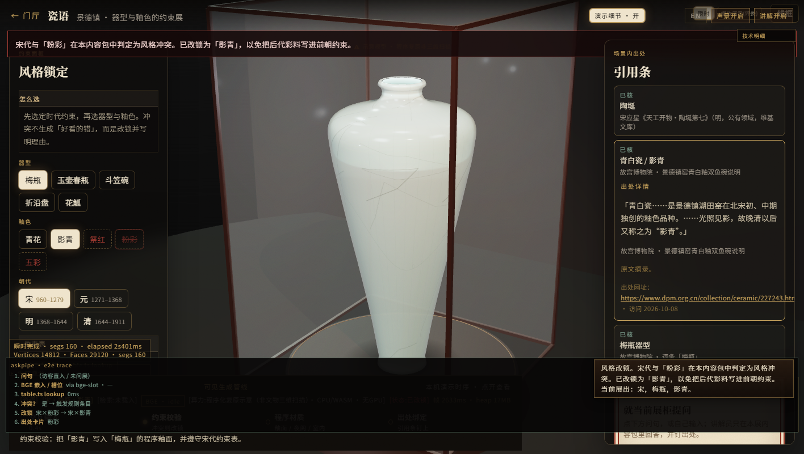

# 赣风 · 出处核对表（CMIT 2026 · 内容准确性）

- 核对日期：2026-10-08（Asia/Shanghai）；万寿宫 2 条于 2026-10-16 补核。
- 登记表：`src/data/sources.ts`（25 条）；规则依据：`src/data/evidenceRules.ts`；审计面板渲染：`src/app/evidence.ts`。
- 引用格式：机构/作者.《题名》[EB/OL]. 网址（访问日期）。摘录为页面原文，省略处用「……」；未改写。
- 25 条中，维基百科「滕王阁」条目与万幼楠《客家民居与赣南围屋》为二手资料；其余为机构页面或公有领域原典。

## 一、状态定义与统计

| 状态 | 定义 | 出处登记（25 条） | 规则表（25 行） |
|---|---|---|---|
| 已核 | 条目页面已直接打开，摘录与页面原文逐字对照，可作为该条事实的依据。 | 25 | 20 |
| 部分核对 | 页面直连失败，只经搜索摘要或旁证页面核对，仅作旁证，不单独支撑结论。 | 0 | 0 |
| 待核 | 尚未找到可公开查证的出处；界面标「待核」。 | 0 | 0 |
| 本展设计约定 | 本展的叙事或交互规则（如冲突改锁、一个情境只锁一个地名锚点），不是史实断言；界面标「本展说明 / 设计约定」。 | 0 | 4 |
| 示例 | 演示用的虚构或占位内容，不对应外部出处；界面标「示例」。 | 0 | 1 |
| 合计 | — | 25 | 25 |

登记表 25 条在 `src/data/sources.ts` 中全部为 `verified`。规则表的「本展设计约定」只说明规则性质，其事实前提仍须为已核条目（见客家、万寿宫两节）。

图注：图 1　审计面板「展示 → 验证」页，逐条列出来源、状态与原文摘录。截图文件：`docs/submit14/screenshots/12-审计验证.png`。

## 二、出处登记（25 条）

| id | 出处（统一格式） | 状态 | 核对说明 |
|---|---|---|---|
| dpm-fencai | 故宫博物院.《粉彩桃花纹直颈瓶（藏品页 · 附「粉彩」词条）》[EB/OL]. https://www.dpm.org.cn/collection/ceramic/226714.html（2026-10-08）. | 已核 | — |
| shm-fencai | 上海博物馆.《艳丽清逸（展览资源页）》[EB/OL]. https://www.shanghaimuseum.net/resource/museum_files/show_files/20161026154409611/P3.html（2026-10-08）. | 已核 | 第二轮以 curl 打开原页，摘录逐字对照；与故宫词条互证。 |
| dpm-hongyou | 故宫博物院.《红釉（词条）》[EB/OL]. https://www.dpm.org.cn/lemmas/242454.html（2026-10-08）. | 已核 | — |
| dpm-xianhong | 故宫博物院.《鲜红釉盘（藏品页 · 附「鲜红釉」词条）》[EB/OL]. https://www.dpm.org.cn/collection/ceramic/227408.html（2026-10-08）. | 已核 | 「灯草口」成因见本条。 |
| dpm-wucai | 故宫博物院.《五彩（词条）》[EB/OL]. https://www.dpm.org.cn/lemmas/239440.html（2026-10-08）. | 已核 | — |
| dpm-qinghua | 故宫博物院.《青花（词条）》[EB/OL]. https://www.dpm.org.cn/lemmas/239391.html（2026-10-08）. | 已核 | — |
| dpm-qingbai | 故宫博物院.《景德镇窑青白釉双鱼碗（藏品页 · 附「湖田窑」词条）》[EB/OL]. https://www.dpm.org.cn/collection/ceramic/227243.html（2026-10-08）. | 已核 | — |
| dpm-meiping | 故宫博物院.《梅瓶（词条）》[EB/OL]. https://www.dpm.org.cn/lemmas/239389.html（2026-10-08）. | 已核 | — |
| dpm-yuhuchun | 故宫博物院.《玉壶春瓶（词条）》[EB/OL]. https://www.dpm.org.cn/lemmas/241111.html（2026-10-08）. | 已核 | — |
| dpm-gu | 故宫博物院.《觚（词条）》[EB/OL]. https://www.dpm.org.cn/lemmas/241138.html（2026-10-08）. | 已核 | — |
| dpm-douli | 故宫博物院.《定窑白釉刻花菊瓣纹笠式碗（藏品页）》[EB/OL]. https://www.dpm.org.cn/collection/ceramic/228029.html（2026-10-08）. | 已核 | 证明北宋已有斗笠式碗（定窑一例）；景德镇窑实例见 wj-douli。 |
| tiangong | 宋应星（明）· 维基文库（公有领域）.《天工开物 · 陶埏第七》[EB/OL]. https://zh.wikisource.org/zh-hans/天工開物/陶埏第七（2026-10-08）. | 已核 | 1637 年（明崇祯十年）刊行为通行说法；刊行年见维基文库《天工开物》总目页。 |
| ihchina-jdz | 中国非物质文化遗产网 · 中国非物质文化遗产数字博物馆.《景德镇手工制瓷技艺（国家级非遗项目页）》[EB/OL]. https://www.ihchina.cn/project_details/14270/（2026-10-08）. | 已核 | 项目序号 357，编号 Ⅷ-7，2006 年第一批。 |
| dpm-zheyan | 故宫博物院.《景德镇窑青花鸳鸯荷花（“满池娇”）纹花口盘（藏品页）》[EB/OL]. https://www.dpm.org.cn/collection/ceramic/226855.html（2026-10-08）. | 已核 | 证明元代景德镇已有折沿盘，不表示折沿盘始于元代。 |
| wj-douli | 常州市武进区博物馆（作者：张彩英）.《北宋景德镇窑青白釉斗笠碗（史河流韵）》[EB/OL]. http://www.wjmuseum.cn/html/article1077813.html（2026-10-08）. | 已核 | 1984 年剑湖砖瓦厂宋墓出土。 |
| ws-tengwang | 王勃（唐）· 维基文库（公有领域）.《滕王阁序（秋日登洪府滕王阁饯别序）》[EB/OL]. https://zh.wikisource.org/zh-hans/滕王阁序（2026-10-08）. | 已核 | 写作年龄有「时年仅十四」（《唐摭言》）与「作于上元二年」两说；本展不取具体年份。 |
| wiki-tengwangge | 维基百科（引《旧唐书·滕王元婴传》等）.《滕王阁（条目）》[EB/OL]. https://zh.wikipedia.org/zh-cn/滕王阁（2026-10-08）. | 已核 | 二手资料；南昌市人民政府「滕王阁」页直连超时，未能打开核对。 |
| eco-poyang | 生态中国网（来源：湿地中国）.《中国最大淡水湖泊—鄱阳湖简介》[EB/OL]. http://www.eco.gov.cn/news_info/22194.html（2026-10-08）. | 已核 | 本展写「鄱阳湖一带的古称」，不写完全等同。 |
| gmw-hengyang | 孟国栋、孙晓磊 · 《光明日报》2020-12-07 第13版（光明网）.《光明日报文学遗产版：也说“衡阳雁”》[EB/OL]. https://news.gmw.cn/2020-12/07/content_34435329.htm（2026-10-08）. | 已核 | 原文指出「雁不过衡阳」是观念，大雁可飞至衡阳以南。 |
| ln-weiwu | 龙南市人民政府（市文化广电旅游局）.《世界围屋之都》[EB/OL]. https://www.jxln.gov.cn/lnzf/c103681/202509/339291f127644234b03dbf97406aff2f.shtml（2026-10-08）. | 已核 | 376 座、2012 年预备名单、2014 年国家级非遗、方形居多。 |
| ln-guanxi | 龙南市人民政府（市文化广电旅游局）.《世界围屋之都 · 关西新围 / 乌石围（同页）》[EB/OL]. https://www.jxln.gov.cn/lnzf/c103681/202509/339291f127644234b03dbf97406aff2f.shtml（2026-10-08）. | 已核 | 关西新围中轴祠堂、四角炮楼；乌石围围前禾坪。 |
| gn-minju | 万幼楠 · 客家摇篮网.《客家民居与赣南围屋》[EB/OL]. http://www.gnhakka.com/n493/n534/c6120/content.html（2026-10-08）. | 已核 | 署名专业文章，载地方客家文化网站；作二手资料使用，非政府公文。 |
| mct-tulou | 文化和旅游部官网（来源：中国文化报）.《“福建土楼”入选〈世界遗产名录〉》[EB/OL]. https://www.mct.gov.cn/whzx/tpxw/200807/t20080708_828614.htm（2026-10-08）. | 已核 | 土楼「或方或圆，以圆为主」；用于区分围屋与土楼。 |
| ih-wanshou | 中国非物质文化遗产网 · 中国非物质文化遗产数字博物馆.《庙会（西山万寿宫庙会）（国家级非遗项目页）》[EB/OL]. https://www.ihchina.cn/project_details/15133.html（2026-10-16）. | 已核 | 万寿宫扩展线；2011 年第三批国家级非遗。 |
| gov-ich3 | 文化和旅游部政府信息公开.《国务院关于公布第三批国家级非物质文化遗产名录的通知》[EB/OL]. https://zwgk.mct.gov.cn/zfxxgkml/fwzwhyc/202012/t20201206_916812.html（2026-10-16）. | 已核 | 第三批名录第 991 项，Ⅹ-84，申报地区江西省新建县。 |

## 三、规则 → 出处 → 状态

### 瓷语（朝代 × 釉色）

| 规则 | 依据（摘录要点） | 出处 | 状态 | 说明 |
|---|---|---|---|---|
| 宋/元/明 × 粉彩 = 冲 → 改锁；清 × 粉彩 = 合 | 「创烧于康熙晚期，成熟于雍正、乾隆两代」 | dpm-fencai、shm-fencai | 已核 | 合/勉/冲的划分是本展设计约定。 |
| 宋 × 祭红 = 冲；元 × 祭红 = 勉；明清 = 合 | 「景德镇窑自元代开始烧造高温铜红釉瓷器，初创阶段呈色多偏暗」；永宣纯正，亦称祭红 | dpm-xianhong、dpm-hongyou | 已核 | 元由冲改勉依据本条；合/勉/冲划分是本展设计约定。 |
| 宋/元 × 五彩 = 冲；明清 = 合 | 「明宣德时已有五彩」；五彩在宋元釉上加彩基础上发展 | dpm-wucai | 已核 | 元判冲是本展取舍，审计面板标为「边界」。 |
| 宋 × 青花 = 勉；元明清 = 合 | 「元代景德镇已能烧制成熟的青花瓷器」 | dpm-qinghua、ihchina-jdz | 已核 | — |
| 宋元 × 影青 = 合；明清 = 勉 | 湖田窑北宋初、中期独创青白瓷；「明代以烧造青花瓷为主」 | dpm-qingbai | 已核 | — |
| 器型：梅瓶、玉壶春、觚、斗笠碗 | 见各词条；斗笠碗另有武进博物馆藏北宋景德镇窑青白釉斗笠碗（1984 年宋墓出土） | dpm-meiping、dpm-yuhuchun、dpm-gu、dpm-douli、wj-douli | 已核 | — |
| 器型：折沿盘 | 元「青花鸳鸯荷花纹花口盘……十六瓣菱花口，折沿」 | dpm-zheyan | 已核 | 界面只写「元代景德镇已有」，不写始于何时；「便于捧持」为本展描写。 |
| 「灯草口」成因 | 釉层高温垂流变薄、露胎色，不是铜挥发 | dpm-xianhong | 已核 | 本轮纠错：原写「灯草白」。 |
| 展柜尺寸 | 原「高 32cm」等数字无出处，已删除，界面改为「示意模型 · 无实物尺寸」 | — | 示例 | 界面按示例标注，不对应外部出处。 |

### 阁序（情境 × 意象）

| 规则 | 依据 | 出处 | 状态 | 说明 |
|---|---|---|---|---|
| 落霞孤鹜 × 落霞/孤鹜/秋水 = 合；× 渔舟/雁阵 = 冲 | 「落霞与孤鹜齐飞，秋水共长天一色」 | ws-tengwang | 已核 | 原文锚定；冲是本展设计约定。 |
| 渔舟唱晚 × 雁阵 = 冲 | 「渔舟唱晚，响穷彭蠡之滨；雁阵惊寒，声断衡阳之浦」，同联对句，地名锚点不同 | ws-tengwang、eco-poyang、gmw-hengyang | 已核 | 冲是本展设计约定：一个情境只锁一个地名锚点。 |
| 九月三秋 × 寒潭 = 合 | 「时维九月，序属三秋。潦水尽而寒潭清」 | ws-tengwang | 已核 | — |
| 彭蠡 = 鄱阳湖一带古称 | 「鄱阳湖在古代有过彭蠡泽……等多种称谓」 | eco-poyang | 已核 | 写「一带」，不写完全等同。 |
| 滕王阁始建永徽四年、李元婴；1989-10-08 重建落成 | 维基百科条目 | wiki-tengwangge | 已核 | 二手资料；一手页面直连超时。 |
| 王勃写作年龄 | 「十四岁」「上元二年」两说 | ws-tengwang 注 | 本展设计约定 | 本展不取具体年份。 |

### 客家（房间 × 时辰）

| 规则 / 内容 | 依据 | 出处 | 状态 | 说明 |
|---|---|---|---|---|
| 时辰 × 房间整张表（禾坪 × 夜 = 冲等） | — | — | 本展设计约定 | 界面明示「非史料」。 |
| 祖堂在中轴 | 「围屋中轴线是祠堂」 | ln-guanxi | 已核 | — |
| 角楼 = 炮楼，四角各一 | 「围屋四角各建有一座10米高的炮楼」 | ln-guanxi | 已核 | — |
| 禾坪在围前 | 乌石围「围前有禾坪」 | ln-guanxi | 已核 | 实例在围前，本展平面为示意。 |
| 376 座围屋、2012 预备名单、2014 国家级非遗、方形居多 | 见摘录 | ln-weiwu | 已核 | — |
| 围屋 ≠ 土楼；土楼「或方或圆，以圆为主」 | 见摘录 | mct-tulou、ln-weiwu | 已核 | — |
| 天井、正屋、横屋、巷道的功能描述 | 「竖向天井」采光排水；正屋与横屋的组合；「巷」串连；禾坪供洗涤、凉晒；外走马、火角/敌楼 | gn-minju | 已核 | 按万幼楠文改写；外走马与巷合为「示意动线」。 |
| 本地称谓 / 建筑术语 8 条（三重围门、禾坪、竖向天井、厅·堂、正屋、横屋、火角·敌楼、外走马） | 见 gn-minju 摘录 | gn-minju、ln-guanxi | 已核 | 原 7 条无出处的方言词条已删除替换。 |

### 万寿宫（活动 × 时段，扩展线）

| 规则 | 依据（摘录要点） | 出处 | 状态 | 说明 |
|---|---|---|---|---|
| 开朝 × 晨旦 = 合；开朝 × 夜晚 = 冲 → 改锁晨旦 | 「八月（号净月）初一晨旦开朝」 | ih-wanshou | 本展设计约定 | 时间锚点已核；合/勉/冲划分是本展约定。 |
| 戏班 × 夜晚 = 合；戏班 × 晨旦/白日 = 勉 | 「夜晚民间戏班演出」 | ih-wanshou、gov-ich3 | 本展设计约定 | 原文未说白天不演，白天判勉是本展约定。 |

## 四、仍需说明的地方

1. 滕王阁年份依赖维基百科（二手资料）。南昌市政府 `nc.gov.cn`、东湖区 `dhq.nc.gov.cn` 页面第二轮仍连接超时（WebFetch 与 curl 均失败）；能打开时改列一手出处。
2. `gn-minju` 是万幼楠的署名专业文章，登在地方客家文化网站，属二手资料，不是政府公文；答辩时说明。
3. 「便于捧持」「日常用器」等说法是本展描写，界面已标「本展说明」。
4. 客家「房间 × 时辰」约束表是叙事约定，不是史料；界面每格写「时辰搭配是本展叙事约定（非史料）」。
5. 导览里的「声音 / 走法 / 光线」文案是创作性描写，不需要外部出处，答辩时说明。
6. 万寿宫扩展线的时间锚点（晨旦开朝、夜晚戏班、香期七月二十至九月初一）逐字出自非遗项目页；合/勉/冲的划分是本展设计约定。

## 五、已纠正与已删除

- 「灯草白」改为「灯草口」，成因按故宫说法改正：釉层高温垂流变薄、露胎色，不是铜挥发。
- 元 × 祭红：冲 → 勉。依据是元代已能烧铜红釉，只是呈色偏暗。
- 「二元配方」原误引《天工开物》，改引中国非物质文化遗产网（元代）。
- 斗笠碗「宋湖田常见」改为「北宋已有（定窑一例）」；景德镇窑北宋实例另见 `wj-douli`。
- 禾坪位置注明「实例在围前，本展平面为示意」。
- 删除无出处的展品尺寸，以及「乾隆转心」「铁斑」等说法。
- 客家方言词条 7 条无出处，已替换为万幼楠文中有原文的空间术语 8 条。
- 房间功能按原文改写：天井为「竖向天井」采光排水；禾坪用途从「晒谷」改为「洗涤、凉晒」。
